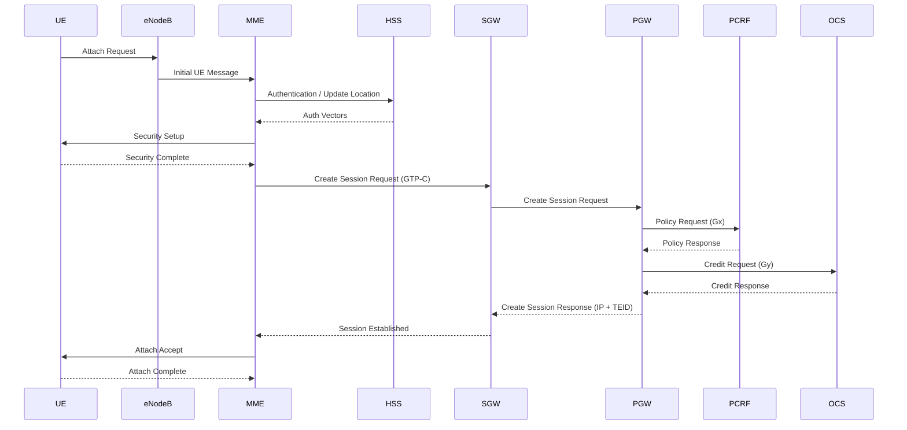
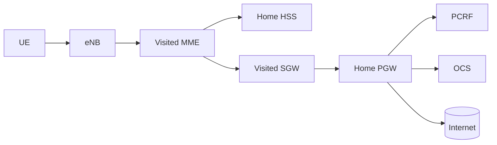
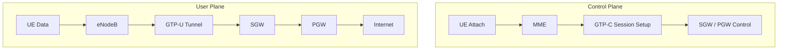
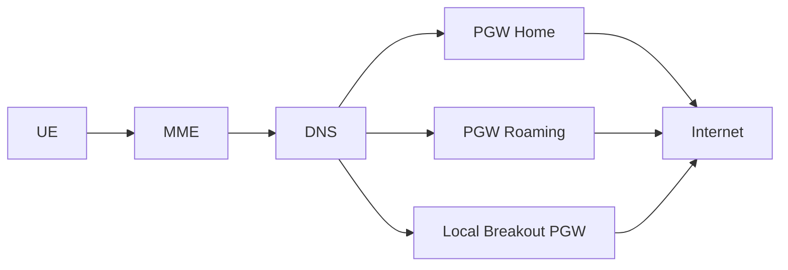
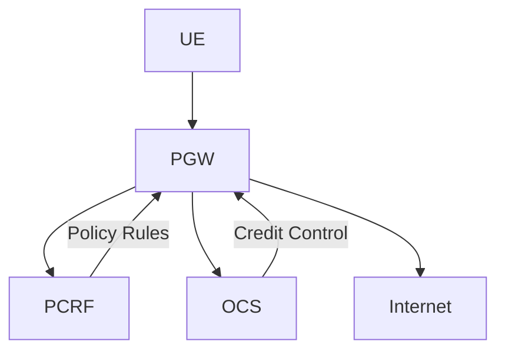

# LTE End-to-End Signaling & Data Flow Diagrams

## 📡 1. LTE Attach + Data Session (Full Flow)

---

## 🌍 2. Roaming Architecture Flow

---

## 🔌 3. GTP-C vs GTP-U Separation

---

## 🌐 4. DNS-Based PGW Selection

---

## 💳 5. Charging + Policy Interaction

---

## 🧠 PacketAlchemy Insight

In real networks:

- Attach success ≠ Internet success
- Each domain can independently block service:
  - DNS → wrong routing
  - PCRF → policy denial
  - OCS → credit block
  - GTP-U → transport failure

---

## 📌 Design Philosophy

These diagrams represent:

✔ Control Plane (GTP-C, Diameter)  
✔ User Plane (GTP-U)  
✔ Policy Control (PCRF)  
✔ Charging (OCS)  
✔ Routing (DNS)

---

## 👤 Author

PacketAlchemy  
Telecom Engineering Notes | EPC | LTE | 5G Core | Network Architecture
