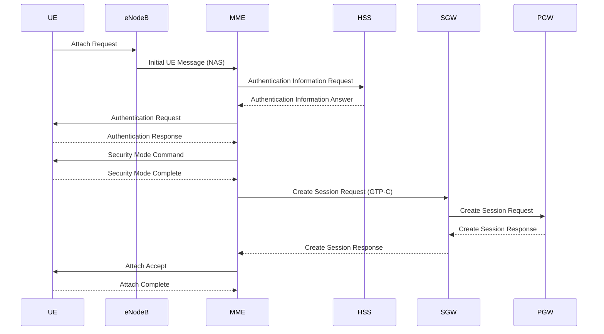

# LTE Attach Procedure (EPC)

## Overview

The LTE Attach procedure is the initial signaling process that allows a User Equipment (UE) to register to the EPC network and obtain IP connectivity.

This process involves multiple core network elements and signaling protocols such as NAS, S1AP, GTP-C, and Diameter.

---

## 🧩 Network Elements

- UE (User Equipment)
- eNodeB
- MME (Mobility Management Entity)
- HSS (Home Subscriber Server)
- SGW (Serving Gateway)
- PGW (Packet Data Network Gateway)

---

## 🔄 High-Level Attach Flow

### 1. Initial Attach Request
UE sends an **Attach Request** via eNodeB to MME.

### 2. Authentication
MME communicates with HSS:
- Authentication Request
- Authentication Response

### 3. Security Setup
- NAS Security Mode Command
- Ciphering & Integrity protection activated

### 4. Location Update / Subscription
- MME updates subscriber info from HSS

### 5. Bearer Setup
- SGW and PGW are selected
- Default EPS bearer is created

### 6. IP Allocation
- PGW assigns IP address to UE

### 7. Attach Accept
- MME sends Attach Accept to UE
- UE becomes fully registered

---

## 🔌 Key Protocols

- NAS (Non-Access Stratum)
- S1AP (eNodeB ↔ MME)
- GTP-C (Control plane between SGW / PGW)
- Diameter (MME ↔ HSS)

---

## ⚙️ Simplified Flow

UE → eNodeB → MME → HSS  
MME → SGW → PGW → Internet

---

## 🧠 Troubleshooting Notes

Common issues in Attach procedure:

- Authentication failure (HSS issues)
- No IP allocation (PGW / APN issue)
- DNS resolution failure
- Subscription restrictions (OCS / PCRF)
- Roaming denial

---
## 📊 LTE Attach Signaling Flow (Diagram)

## 📌 Author

PacketAlchemy  
Telecom Engineering Notes | PS Core | EPC | LTE
